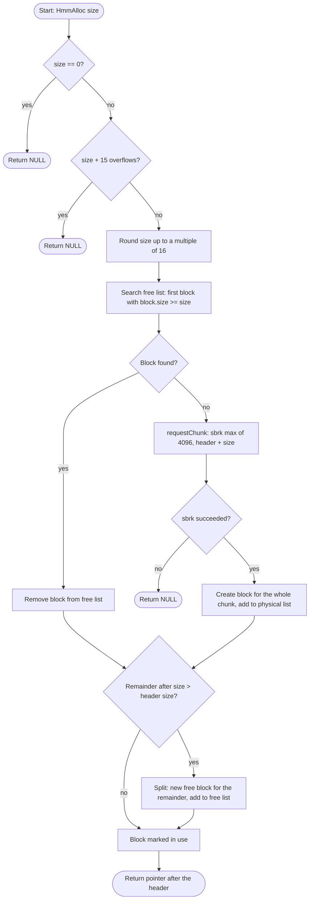
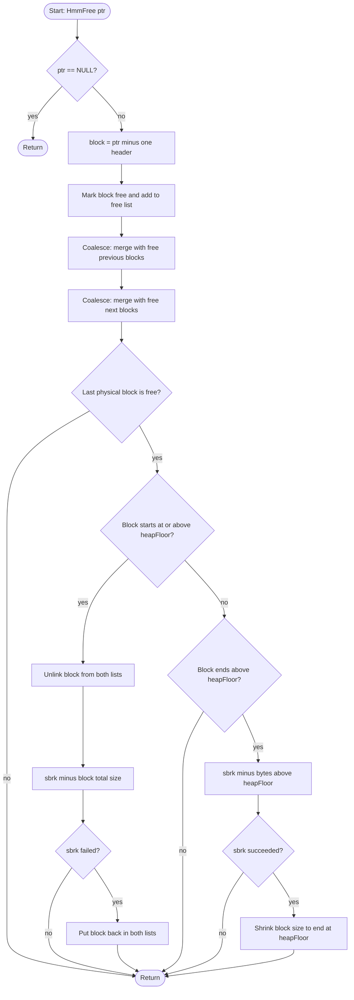

# Heap Memory Manager (HMM)

A replacement for the C library `malloc`, `free`, `calloc` and `realloc`, written for Linux. It gets memory from the OS with `sbrk()`, hands it out in blocks, and gives it back when it is no longer needed.

## Project layout

```
inc/Hmm.h            Public API
src/internal.h       BlockHeader and internal function declarations
src/HmmAlloc.c       HmmAlloc, hmmCalloc, hmmReAlloc, hmmSize + list/heap helpers
src/HmmFree.c        HmmFree
src/heapWrappers.c   malloc/free/calloc/realloc -> Hmm functions
test/main.c          Test program
Makefile             Build targets
```

## Build and run

```sh
make               # static library + test executable
make static_lib    # build/lib/libhmm.a
make shared_lib    # build/lib/libhmm.so
make test          # build/hmm_test
./build/hmm_test
make clean
```

Use it on a normal program with `LD_PRELOAD`:

```sh
make shared_lib
LD_PRELOAD="$(pwd)/build/lib/libhmm.so" ls -la
```

## Design

### 1. Block layout

Every allocation is a **header** followed by the **user memory**. The pointer returned to the user points just after the header.

```
 +----------------+------------------------------+
 |  BlockHeader   |  user memory (size bytes)    |
 |   48 bytes     |                              |
 +----------------+------------------------------+
 ^                ^
 block            pointer returned to the user
```

```c
typedef struct BlockHeader {
    size_t size;                    /* user bytes, header not included */
    int    free;                    /* 1 = free, 0 = in use            */
    struct BlockHeader *prev_phys;  /* physical neighbours             */
    struct BlockHeader *next_phys;
    struct BlockHeader *prev_free;  /* free-list neighbours            */
    struct BlockHeader *next_free;
} BlockHeader;
```

The header is 48 bytes, a multiple of 16. Together with sizes rounded up to a multiple of 16, this keeps **every returned pointer 16-byte aligned**, which x86-64 code (glibc, SSE) requires.

### 2. Two lists

| List | Contains | Used for |
|------|----------|----------|
| **Physical list** (`heapHead`) | All blocks, in address order | Finding the neighbours of a block for coalescing, finding the last block for releasing memory |
| **Free list** (`freeHead`) | Only free blocks, doubly linked, new blocks added at the front | Fast search for a block to reuse |

### 3. Allocation (`HmmAlloc`)

1. `size == 0` returns `NULL`. The C standard allows `malloc(0)` to return either `NULL` or a unique pointer, and this allocator chooses `NULL`.
2. The size is rounded up to a multiple of 16 (after checking it cannot overflow).
3. **First-fit**: walk the free list and take the first block with `size >= requested`.
4. If found: remove it from the free list and **split** it (see below).
5. If not found: ask the OS for a new chunk with `sbrk` and split that.
6. Return the address just after the header.

**Splitting.** If the block is bigger than needed and the remainder can hold a header plus at least 1 byte, the remainder becomes a new free block placed right after the allocated part. Otherwise the whole block is given to the user.

**Heap growth.** `requestChunk` asks the OS for `max(4096, header + size)` bytes. Asking for at least 4096 bytes at a time keeps the number of `sbrk` system calls low. The unused part of a chunk is split off as a free block and reused by later allocations.

### 4. Free (`HmmFree`)

1. `free(NULL)` does nothing.
2. Mark the block free and add it to the free list.
3. **Coalesce**: merge with every free physical neighbour before and after it, so free space does not get cut into small pieces.
4. **Release trailing memory**: if the last block of the heap is free, give memory back to the OS (see next section).

### 5. Shrinking the heap and `heapFloor`

The first time the heap is grown, the allocator saves the end of that first chunk in `heapFloor`. It is set once and never changed.

`releaseTrailingMemory` looks at the last physical block. If it is free:

- **The block starts at or above `heapFloor`:** the whole block is removed and returned to the OS with `sbrk(-n)`.
- **The block starts below `heapFloor` but ends above it:** only the part above `heapFloor` is returned. The rest stays as a smaller free block.
- **The block ends at or below `heapFloor`:** nothing is released.

So the program break never goes below the end of the first chunk. This keeps the heap from shrinking and growing again on every free/malloc pair, which reduces `sbrk` calls. It also means the heap returns to the same break the program saw after its first allocation.

If `sbrk` fails while shrinking, the block is put back in the lists and nothing is lost.

### 6. `hmmCalloc`

Checks `nmemb * size` for overflow, calls `HmmAlloc`, then fills the memory with zeros.

### 7. `hmmReAlloc`

| Case | Behaviour |
|------|-----------|
| `ptr == NULL` | Same as `HmmAlloc(size)` |
| `size == 0` | Frees `ptr` and returns `NULL` |
| Block already large enough | Keeps the block, splits off any big remainder |
| Next physical block is free and the two together are big enough | Grows **in place** by absorbing the next block |
| Otherwise | Allocates a new block, copies the old data, frees the old block |

### 8. `hmmSize`

Reads the `size` field from the header in front of the pointer.

## Flowcharts

### HmmAlloc



### HmmFree



## Testing

`test/main.c` runs these checks:

1. **First test:** many small, large and huge allocations, all freed. The program break must end where it was after the first allocation.
2. **Second test:** data written to blocks is still intact when read back.
3. **Third test:** many tiny allocations and frees.
4. **REALLOC test:** data survives growing a block.
5. **CALLOC test:** memory is zeroed.

```
First test: succeeded
Second test: succeeded
Third test: succeeded
REALLOC test: succeeded
CALLOC test: succeeded
```

The allocator also runs standard programs under `LD_PRELOAD` (`ls`, `cat`, `date`, `echo`).

The extra test from the assignment (`free_and_sbrk.c` from *The Linux Programming Interface*):

```sh
make static_lib
gcc -Iinc -Itest/tlpi test/tlpi/free_and_sbrk.c test/tlpi/error_functions.c test/tlpi/get_num.c build/lib/libhmm.a -o free_and_sbrk
```

Initial program break:          0x62bc36b00000
Allocating 1000*10240 bytes
Program break is now:           0x62bc374cfb80
Freeing blocks from 1 to 1000 in steps of 2
After free(), program break is: 0x62bc374cfb80

## Return values and error handling

- `sbrk` failure (growing or shrinking) is always checked. Growing returns `NULL` to the caller. Shrinking restores the block.
- `HmmAlloc` and `hmmReAlloc` return `NULL` if the requested size would overflow.
- `hmmCalloc` returns `NULL` if `nmemb * size` overflows.
- A failed `realloc` leaves the original block untouched.

## Known limitations

- **Not thread-safe.** There is no locking.
- **First-fit can fragment** the heap over time.
- **Linear search.** The free-list search and `getLastBlock` (which walks the physical list) are O(n).
- **Real `sbrk` is used.** The allocator assumes nothing else moves the program break. Other code calling `sbrk` can break the assumption that chunks are contiguous.
- **A new chunk is not merged with a free block at the end of the heap.** It is added as a separate block, which can leave two free blocks next to each other until a later `free` coalesces them.
- `malloc(0)` returns `NULL`. This is allowed by the C standard, but some programs treat `NULL` as an out-of-memory error.
- Only alignment up to 16 bytes is guaranteed.
- Statically linked programs and set-user-ID programs ignore `LD_PRELOAD`.
